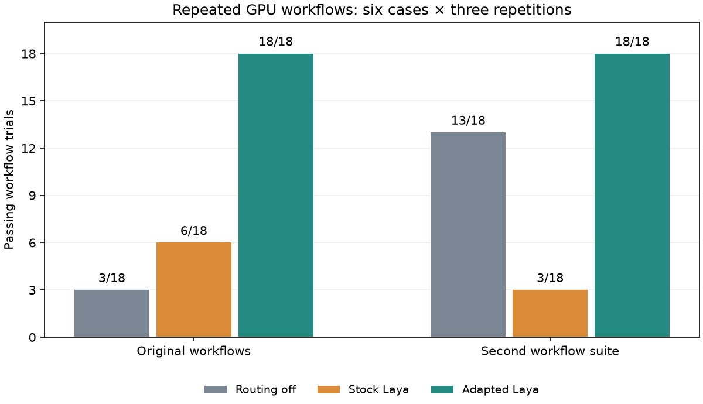

# Repairing Laya bound routing

The earlier 2/18 result was a failed integration, not a completion criterion.
This follow-up reproduces the failure, repairs argument binding and execution-step
questions, adapts the classifier on synthetic routing data, and reruns the real
SGLang/Prism/MCP workflow. Historical grades and fixtures are unchanged.

## Final repeated GPU workflows

| Suite | Routing off | Stock Laya, bound | Adapted Laya + fixes, bound |
|---|---:|---:|---:|
| Original | 3/18 | 6/18 | 18/18 |
| Initially independent | 13/18 | 3/18 | 18/18 |


Each cell contains six cases repeated three times. Arms rotate by repetition;
all use the same Qwen3-8B-AWQ SGLang worker, clean Prism build, temperature 0.1,
4096 output-token cap, and 180-second trial timeout. Both Laya endpoints execute
on the shared RTX 5060 Ti, with zero CPU fallbacks. Reports retain failures,
full requests, tool invocations, route decisions, timings, and resource telemetry.
No configured business MCP server is contacted: downstream tools are synthetic
HTTP MCP fixture servers. The primary generative model and classifiers are live.

The original and initially independent suites are now **development regressions**:
we inspected their failures while tuning. Neither final score establishes unseen
workflow accuracy. The earlier cross-runtime report remains an immutable account
of the earlier binary, prompts, and model. Do not pool its arms with these.

The adapted arm passed **36/36**, compared with **9/36** for stock bound routing
and **16/36** with routing off in this matched matrix. Each adapted case passed all
three repetitions. This is a repair of the observed integration failures, with
the generalization limits below. The final stock arm dispatched 6 synthetic
write-tool calls, and the adapted arm dispatched 0. Together with the earlier
bridge matrix, this follow-up retains 12 synthetic write-tool invocations; none
contacted real records. Faster failures are not a useful latency advantage.
Minimum free GPU memory was 1375 MiB and minimum available host memory
was 10.66 GiB across 152 telemetry samples.



## What failed and what changed

1. **Stock choice semantics did not match workflow routing.** The generic question
   asked which tool directly carries out the whole task. Laya chose writes for
   read-only requests, skipped prerequisite IDs, repeated completed reads, or
   finished before a linked record was retrieved. The original owner red repro
   is retained in `baseline-owner/`: stock chose `tracker.update_issue`, while
   Qwen attempted `work.get_issue` and the runtime correctly rejected the bypass.
   Forty-eight wrapper/question/label ablations, another 28 semantic probes,
   hierarchical routing probes, and SDK/multilingual parity checks did not solve
   the actual workflow catalog. Simple natural-language cases were insufficient.
2. **The generated argument schema duplicated a destination the runtime owned.**
   Native tool parsing expected input fields, while the bridge advertised a nested
   `{server, tool, arguments}` wrapper. Commit `de87331` advertises the selected
   downstream tool's actual input schema and binds its destination in the runtime.
   Valid native fields named `server`, `tool`, or `arguments` retain their meaning.
   Matching legacy wrappers remain compatible; wrong destinations and invalid
   arguments never dispatch. The production MCP regression covers direct, nested,
   flattened, bypass, and invalid arguments, with no grading-oracle changes.
3. **The bound question ignored execution phase.** Commit `a124df7` adds an
   explicit choice-question method and records its exact question in each route.
   The first question asks for prerequisite identifiers; subsequent questions ask
   for the next action given completed results. The advisory request stays
   unchanged. The final questions were selected on development traces: 26/26
   state probes passed, while an alternative empty/denied phrasing passed 25/26.
   These are tuning diagnostics, not independent test results.

The exact first question is:

> Choose the first tool call required by the task. Obtain prerequisite identifiers before following linked records.

After any completed downstream call:

> Choose the next action needed for the task using the completed results. Finish only after the requested records have been retrieved.

The model still receives the task, actual completed evidence, and explicit
choices on every decision. It does not discover tools, execute MCP, or produce
general arguments. The parent/runtime owns those operations and authorization.

## Model adaptation and independent classifier checks

The stock English checkpoint is `convaiinnovations/laya` revision
`55cf4c4ebb4ebe31b2550e8bdf3bd21b99753851`, approximately 421M parameters.
Training used official `laya.train.finetune` from SDK 0.4.8, PyTorch 2.8.0 CUDA
12.8, Transformers 5.17.0, seed 1049, and the same base checkpoint.

- An initial corpus generator accidentally correlated scenario and entity indices.
  Its audit caught the defect before training; the rejected corpus and reason are
  retained under `aborted-corpus-v0/`.
- A CPU timing pilot stopped before an epoch. A GPU head-only pilot used 168
  training and 24 calibration examples for two epochs; development accuracy stayed
  51.04%. It was rejected.
- **V2:** 768 synthetic examples, split 672 training/96 calibration; 96 separate
  development examples. Eight training entity domains differ from classifier
  validation domains. Catalog sizes vary from 2–8 choices, with shuffled option
  order, explicit writes/read-only tasks, empty/denied results, injection/history,
  finish/abstain choices, and linked evidence. Full encoder training for four
  epochs improved development accuracy 43.75% → 90.62%. A selected-before-scoring
  144-state domain check improved stock 66/144 → V2 126/144; templates are related
  to training, so this is limited domain-transfer evidence. The budget/overlap
  audit found no truncation or exact train/development/validation overlap.
- **V3:** continuation with 256 replay examples and 512 additional synthetic
  dependency states, split 672 training/96 calibration. Two epochs improved the
  168-example development set 84.52% → 99.40%. The curriculum balances prerequisite,
  child retrieval, finish, and direct-child counterexamples with new descriptions.
  No real issue/project/cycle IDs, fixture responses, or expected decision facts
  enter the training corpus. Workflow structure and failure analysis informed the
  curriculum, so this is task adaptation rather than a blind benchmark.

Final model weight SHA-256:
`1920ee68f11b2d657b8500448f31c0ff8d56e8eca2913e978991ae3c7bb7c991`.
V2 weight SHA-256:
`11b9ea87a1431a22f1193e494ba34930ecb8e86832112c83ab3779fd7e5d5019`.

A separate set was frozen before V3 training: **56 states in four new domains,
each scored in normal and reversed option order (112 decisions)**. Its original
whole-task question produced stock **42/112** and V3 **90/112**. Reapplying the
later phase-aware question policy to that same set produced stock **38/112** and
V3 **88/112**. The latter is explicitly post-hoc reuse of the validation set.
It is not a new held-out test, and phase prompts did not improve this broader
classifier set. Order pairs are correlated, not 112 independent tasks.

Calibration on the synthetic split was saturated near probability 1.0; the SDK
warned confidence was uncalibrated. No confidence threshold, universal accuracy,
or broad autonomous-action safety claim follows from these results.

## Stage-by-stage workflow evidence

| Prism / question / model stage | Original stock | Original adapted | Independent stock | Independent adapted |
|---|---:|---:|---:|---:|
| Published v0.1.35, old question, V2 | 10/18 | 14/18 | 3/18 | 11/18 |
| Argument binding fix, old question, V2 | 8/18 | 15/18 | 3/18 | 15/18 |
| Binding + phase questions, V3, GPU | 6/18 | 18/18 | 3/18 | 18/18 |

The first two matrices contain 144 scored trials. V2 inference in those matrices
ran on the isolated workstation CPU service; stock inference ran on the cluster
GPU. They diagnose correctness; they do **not** compare classifier latency. The
final matrix runs both classifiers on the GPU and includes a matched routing-off
arm. The linked project/cycle failures remaining after V2 motivated the V3
curriculum and first/next questions. Both final stock and adapted arms use the same repaired Prism binary.
These interventions are not a factorial study;
the final score cannot isolate an individual contribution from all three fixes.

Six stock V2-bridge trials dispatched `update_issue` to synthetic fixture servers;
all returned fixture argument mismatch. No real records were changed. The prior
report's zero-write statement applies only to its earlier cohort. Native argument
binding improves dispatch reliability, including for a wrongly selected tool;
it is not a task-scoped write authorization mechanism. Automatic recommendation
injection remains disabled locally. Use appropriate tool/agent authorization for
writable catalogs; this work does not add a per-task read-only guard.

## Deployment and MCP verification

Homelab main now serves stock and routing endpoints separately:

| Purpose | Origin | Identity |
|---|---|---|
| General English Laya | `https://laya-gpu.iambarton.com` | stock revision `55cf4c4…` |
| Experimental English tool choice | `https://laya-routing.iambarton.com` | `local-sha256:1920ee68…` |

Image: `ghcr.io/bryanbarton525/laya@sha256:db08d7dca6af272734285f157a2747a7f8010af308b4a5697e6825339c88fc4a`.
Image source: homelab commit `6d46972b970b779ac3d4a2812855782283be2ddb`;
its build completed successfully before deployment. Separate server ports share a
single GPU slot and a reentrant inference lock. Parameters use fp16 storage;
fp32 rotary buffers and SDK autocast policy are preserved. Twelve ordinary
billing/technical/sales stock control requests retained all twelve top choices
after this storage/package change; this is a small regression control, not proof
of universal numerical equivalence.

The official MCP wrapper requires an object for `state`. Wrapping the text
initially broke the linked-project decision. A failing regression led to
normalizing only `{"text": "..."}` to the identical string on the specialized
endpoint, for single and batch requests. Other objects retain structure. The
stock endpoint keeps SDK semantics. Three actual local CLI MCP calls then selected
the correct owner, prerequisite issue, and linked project routes. A fresh published
Prism MCP host also discovers the server and passes all three predictions through `call_mcp_tool`.
The installed parent skill now documents this exact tested protocol.

The registered `laya-routing` wrapper is in the default MCP server allowlist along
with existing servers. Registration is a callable classification capability;
it does not enable automatic routing or change the general Laya origin.
See [configuration instructions](../../../decision-services.md).

**The installed executable remains the published v0.1.35**, commit
`83a9727986fa1c65ecf4a956f5b5c7ef2762eff4`, bundle
`288b3f5c459b38b2ce561f28f49ea88ef57960e0a331693407f83a56b4164da6`.
The final workflow uses an isolated clean development binary from `a124df7…`,
bundle `7266bc265add02a83eab3a55b9d10c319915846486a31b0de19e04987b0e0b3c`.
The Prism changes remain in PR #49 for review and release; no unpublished binary
was installed over the published executable.

## Operational failure retained and repaired

The first curriculum continuation exhausted the 5Gi production model cache while
saving its checkpoint. Its failed log is retained, and that partial checkpoint
was never evaluated as a candidate. The successful retry used a **separate 16Gi
artifact PVC**, with at least 4Gi free checked before training. An owned-artifact
migration verified all 45 file hashes before removing research copies from the
serving cache; stock Hugging Face files were preserved. Serving mounts the new
volume read-only. The exact manifest, migration script/log, retry script, job
records, and resource telemetry are in the diagnostic archive.

SGLang was paused for training and restored to one worker afterward. Ollama is
scaled to zero. SGLang retains its 65,536-token context/cache and 0.80 static memory
fraction. CUDA health checks require both model identities and zero fallbacks.
Research jobs and temporary services/config maps were removed after evidence and
weights were backed up. Model weights remain on the artifact PVC and workstation
backup, outside Git. Secrets and temporary registry/Argo credentials are excluded.

## Artifacts, validation, and reproduction

| File | Contents |
|---|---|
| [workflows.tar.gz](workflows.tar.gz) | 215 verified entries, 2,633,524 bytes |
| [diagnostics.tar.gz](diagnostics.tar.gz) | 221 verified entries, 1,070,340 bytes |
| [workflow-trials.csv](workflow-trials.csv) | 252 scored follow-up trials, per-case checks and report paths |
| [workflow-summary.json](workflow-summary.json) | All stage totals and every synthetic write-tool invocation |
| [final-workflow-resource-summary.json](final-workflow-resource-summary.json) | Final telemetry minima |

Extract archives from this report directory; their paths are relative to the
original experiment root. All completed paired workflow reports are retained;
exports and isolated runtime state are reconstructible duplicates and are omitted.
Training and classifier JSONL, original scripts, failed experiments, checkpoint
file manifests, source identities, journals, telemetry, and build/test logs remain.
GB-scale model weights and development executables are not committed. Verify
`SHA256SUMS` before using the archive.

The original owner repro is included as a diagnostic, outside the 252 paired-trial denominator.
The original red probe, full Go suite and `go vet ./...` passed with isolated
runtime settings after the repair. The six server boundary regressions passed,
including the captured red/green MCP envelope check. The final CLI validated/exported **150 complete reports covering 900 scored trials**: the previous 648 and this follow-up’s 252. All report hashes/grader checks remained valid.

To rerun after building PR #49, point `run_phase_workflows.py` at the checkout and
clean binary, replace its absolute output location with a fresh directory, and
remove/fulfill the recorded endpoint-ready gate after checking both model health
identities. Its saved plan contains every exact invocation. The core bound arm is:

```sh
PRISM_MODEL_RUNTIME_ENGINE=sglang \
PRISM_MODEL_RUNTIME_BASE_URL=http://10.43.88.30:8080/v1 \
PRISM_MODEL_RUNTIME_MODEL= \
PRISM_STATE_DIR=/tmp/prism-routing-rerun \
  ./prism eval run --suite evals/mcp-independent-routing-v1/suite.yaml \
    --model Qwen3-8B-AWQ --repeat 3 --temperature 0.1 \
    --max-tokens 4096 --timeout 180s \
    --laya-url https://laya-routing.iambarton.com --laya-mode first \
    --output /tmp/prism-routing-rerun.json
```

Use a fresh output path. For the stock arm change only the classifier origin;
for off omit both Laya flags. Reproduce the paired order with the archived plan
rather than treating the example's single-arm repetition as the recorded design.
The training scripts include the exact SDK settings, seeds, data hashes, and
checkpoint paths. Pause the generative worker and use the isolated artifact PVC
when reproducing training, restoring normal replicas afterward. Do not train
against either production serving directory.
