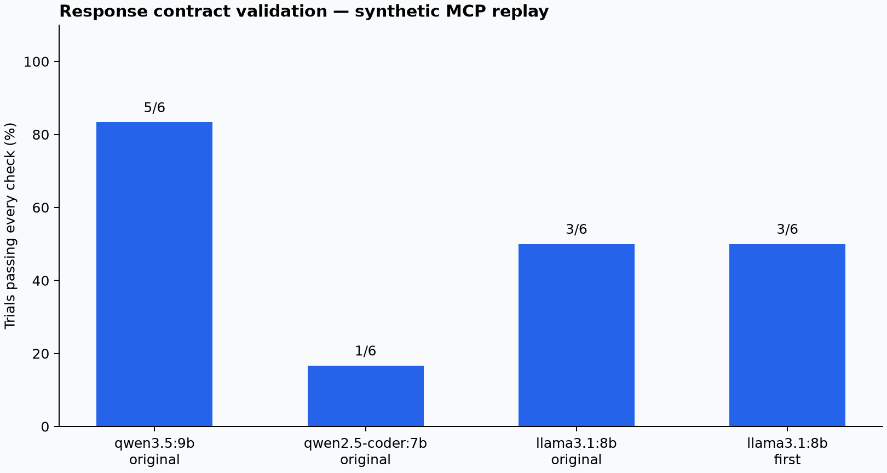
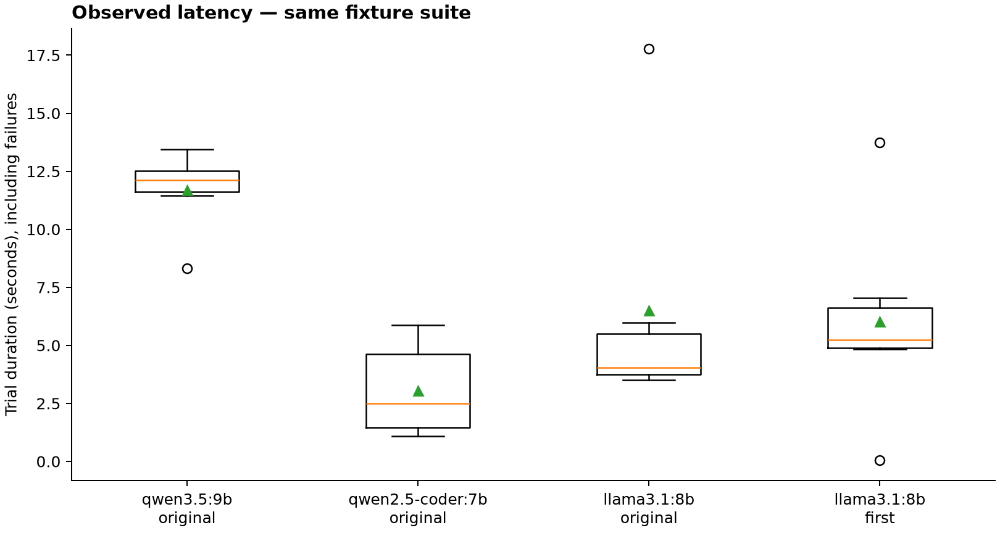

# Response contracts and optional routing

Single-pass smoke results from the fixed implementation. Laya is optional: original mode
uses the model-driven tool loop without contacting Laya. First mode binds
execution to a Laya-selected authorized server/tool before generation.





| Model and mode | All-check passes |
|---|---:|
| qwen3.5:9b / original | 5/6 |
| qwen2.5-coder:7b / original | 1/6 |
| llama3.1:8b / original | 3/6 |
| llama3.1:8b / first | 3/6 |

These are small synthetic integration probes, not a ranking-quality benchmark.
Expected answers stay in graders; models receive schemas and replayed tool evidence.
Failures remain in the data. One repetition cannot establish consistency;
no smoke run is an approved baseline. Repeat at least three times before approval.
The earlier 8/18 original-loop run is retained in `diagnostics/`, on revision ee6284f.
It preceded a Laya bridge-interface correction and is excluded from these charts.
The historical v0.1.32 report used different contracts and advisory routing;
its pass rates are not a controlled before/after comparison.

## Failed checks

| Model and mode | Check | Failed trials |
|---|---|---:|
| llama3.1:8b / first | `decision_schema` | 2 |
| llama3.1:8b / first | `laya_route` | 2 |
| llama3.1:8b / first | `mcp_response` | 2 |
| llama3.1:8b / first | `model_identity` | 1 |
| llama3.1:8b / first | `outcome:0:/decision/match_count` | 1 |
| llama3.1:8b / first | `outcome:0:/decision/project_id` | 1 |
| llama3.1:8b / first | `outcome:1:/decision/issue_ids` | 1 |
| llama3.1:8b / first | `outcome:1:/decision/project_name` | 1 |
| llama3.1:8b / first | `outcome:1:/decision/status` | 1 |
| llama3.1:8b / first | `outcome:2:/decision/health` | 1 |
| llama3.1:8b / first | `required_tool:projects/get_project` | 1 |
| llama3.1:8b / first | `required_tool:tracker/search_issues` | 1 |
| llama3.1:8b / first | `response_schema` | 2 |
| llama3.1:8b / first | `structured_decision` | 2 |
| llama3.1:8b / first | `tool_sequence` | 1 |
| llama3.1:8b / original | `decision_schema` | 1 |
| llama3.1:8b / original | `mcp_response` | 1 |
| llama3.1:8b / original | `outcome:0:/decision/project_id` | 1 |
| llama3.1:8b / original | `outcome:1:/decision/project_name` | 1 |
| llama3.1:8b / original | `outcome:1:/decision/status` | 1 |
| llama3.1:8b / original | `outcome:2:/decision/health` | 1 |
| llama3.1:8b / original | `required_tool:projects/get_project` | 1 |
| llama3.1:8b / original | `required_tool:tracker/get_issue` | 1 |
| llama3.1:8b / original | `response_schema` | 2 |
| llama3.1:8b / original | `tool_sequence` | 1 |
| qwen2.5-coder:7b / original | `decision_schema` | 2 |
| qwen2.5-coder:7b / original | `mcp_response` | 2 |
| qwen2.5-coder:7b / original | `outcome:0:/decision/issue_id` | 1 |
| qwen2.5-coder:7b / original | `outcome:0:/decision/project_id` | 1 |
| qwen2.5-coder:7b / original | `outcome:1:/decision/project_name` | 1 |
| qwen2.5-coder:7b / original | `outcome:1:/decision/status` | 2 |
| qwen2.5-coder:7b / original | `outcome:2:/decision/assignee` | 1 |
| qwen2.5-coder:7b / original | `outcome:2:/decision/health` | 1 |
| qwen2.5-coder:7b / original | `outcome:2:/decision/reason` | 1 |
| qwen2.5-coder:7b / original | `required_tool:projects/get_project` | 1 |
| qwen2.5-coder:7b / original | `required_tool:tracker/get_issue` | 4 |
| qwen2.5-coder:7b / original | `required_tool:tracker/search_issues` | 1 |
| qwen2.5-coder:7b / original | `response_schema` | 1 |
| qwen2.5-coder:7b / original | `structured_decision` | 1 |
| qwen2.5-coder:7b / original | `tool_sequence` | 1 |
| qwen3.5:9b / original | `decision_schema` | 1 |
| qwen3.5:9b / original | `mcp_response` | 1 |
| qwen3.5:9b / original | `outcome:0:/decision/match_count` | 1 |
| qwen3.5:9b / original | `outcome:1:/decision/issue_ids` | 1 |
| qwen3.5:9b / original | `response_schema` | 1 |
| qwen3.5:9b / original | `structured_decision` | 1 |

## Laya findings

The bound path passed issue lookup, conflicting history, and injection-evidence probes.
It abstained on a valid empty-search task. Access denial was retrieved correctly,
but the model placed `access_denied` in the issue-status field instead of null.
For the linked-project task, Laya selected the issue tool again; the model tried
to switch to the project tool, and the runtime rejected that route bypass.
These failures block baseline approval. They distinguish routing selection,
response semantics, and execution enforcement; the small suite does not establish
general ranking quality. Laya remains optional and is not recommended as a default
configuration based on this smoke run.

## Reproduction and provenance

Build revision: `d79ac1f75a53fae8fb42d54abfa900cc6b2e0940`.
Minimum sampled free memory: 77%; peak Ollama resident memory: 5.32 GiB.

See [the guarded runner guide](../../../../evals/README.md). Exact commands,
binary revisions, model digests, generation settings, memory samples, and
The agent also has a 60-second per-invocation latency budget.
CLI-validated raw reports are retained in `data/`. Runs use one resident
small model at a time, unload between blocks, and stop at guard thresholds.

Exact smoke commands (use a binary built from the revision above):

```sh
python3 evals/run_matrix.py --prism /path/to/prism --model qwen3.5:9b --model qwen2.5-coder:7b --model llama3.1:8b --repeat 1 --max-tokens 4096 --output-dir "$HOME/prism-eval-results/new-original"
python3 evals/run_matrix.py --prism /path/to/prism --model llama3.1:8b --repeat 1 --max-tokens 4096 --laya-url https://laya-gpu.iambarton.com --laya-mode first --output-dir "$HOME/prism-eval-results/new-laya"
```

Use new output directories, and run these sequentially. For consistency validation,
increase `--repeat` to at least 3; approve a baseline only when all checks pass.

Regenerate this page and graphs with:

```sh
python3 -m pip install matplotlib
python3 docs/evals/reports/2026-10-20-contract-routing/analyze.py
```
