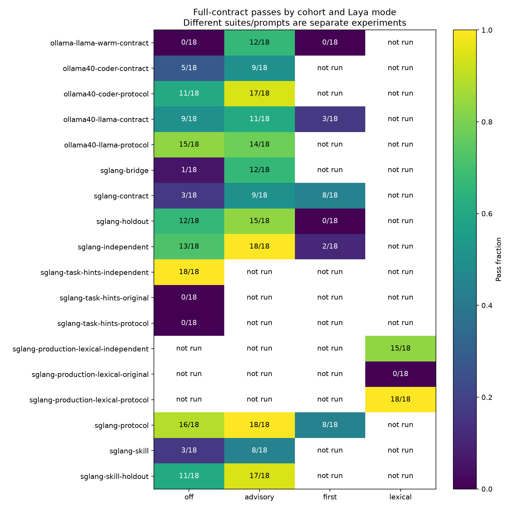

# Cross-runtime Laya and evidence-protocol evaluation

Follow-up: [bound-routing diagnosis and repair](../2026-10-20-bound-routing-repair/README.md)
retains this report’s grades and tests the subsequent argument, question, and model changes.

Collected on the homelab RTX 5060 Ti (16 GiB), after installing **Prism v0.1.35**,
revision `83a9727986fa1c65ecf4a956f5b5c7ef2762eff4`. This report separates
routing quality, actual tool execution, answer correctness, and instruction
placement. The archive contains **648 scored trials in 108 complete reports**,
plus 154 direct classifier probes. There are twelve distinct outcome fixtures
within one synthetic issue-management workflow family; repeats and prompt
variants are not additional independent tasks. Historical reports remain unchanged.
The [review inventory](provenance/reviewed-documents.json) records fourteen
previous evaluation documents. Historical mixed contracts and missing memory
artifacts are not pooled with this collection.

## SGLang findings

Three repetitions of each of six synthetic workflows, using Qwen3-8B-AWQ and
SGLang 0.5.19. The original contracts, fixtures, expected arguments, grading rules,
and generation settings were preserved. All trials, including failures, count.

| Task context | Laya off | Advisory Laya | Bound Laya-first |
|---|---:|---:|---:|
| Original `mcp-response-v2` | 3/18 | 9/18 | 8/18 |
| Explicit evidence-collection protocol | 16/18 | 18/18 | 8/18 |
| Protocol plus unnamed tools and distractors | 12/18 | 15/18 | 0/18 |
| Six new fixtures, frozen before collection | 13/18 | 18/18 | 2/18 |

Advisory Laya improved full-contract passes outside Ollama in these samples.
The matched lexical controls below qualify that gain: much of the improvement
can also come from task context and ordinary hints. These small repeated samples
do not establish statistical significance or a general ranking advantage.

The protocol tells the model to collect evidence through actual MCP calls before
returning its final envelope, to obtain linked IDs from earlier results, and to
preserve the schema's types and nulls. It contains no expected answer values.
The protocol suite changes task instructions; compare modes within that suite,
and treat the cross-suite difference as an instruction ablation rather than an
approved baseline comparison.

The challenge suite removes tool aliases from user tasks and adds plausible
historical-read and write distractors. It reuses the six original outcome
fixtures. Despite `holdout` in filenames and suite ID, this is **not an independent
held-out dataset** and must not be presented as one.

The six new fixtures cover owner/status lookup, nonempty ordered search results,
project access denial, linked cycle lookup, a nullable owner with numeric
priority, and current project records with historical distractors. Their inputs,
expected outcomes, schemas, and canonical tool sequences were frozen at
`c1ab37b` before the first live trial. They share the earlier workflow family,
so they broaden coverage without establishing transfer to unrelated agents.

## Matched lexical controls

The new `--lexical-advice` arm exercises Prism's existing lexical recommender
and appends the same production hint format at the same context position as
advisory Laya. It makes no classifier or embedding requests. Actual first-call
system prompts, tool definitions, generation settings, and user-context prefixes
were checked for equality across eighteen case pairs; only appended hints differ.
See [checks](provenance/matched-context-checks.json).

| SGLang suite | Off | Production lexical | Advisory Laya |
|---|---:|---:|---:|
| Original | 3/18 | 0/18 | 9/18 |
| Explicit protocol | 16/18 | 18/18 | 18/18 |
| New fixtures | 13/18 | 15/18 | 18/18 |

Lexical hints match Laya on the original protocol suite. Laya has three more
passes on the new fixtures, but the repeats are small and correlated. Five
original cases expose only one tool: normalizing the lexical score to 1 makes
the actual input byte-identical to advisory Laya. Those cases cannot demonstrate
learned tool selection; score presentation alone changes the prompt. See the
[single-tool equivalence check](provenance/single-tool-hint-equivalence.json).

On the new nullable-owner fixture, Laya ranked `tracker.update_issue` first
(score 0.3573), while the correct `work.get_issue` was second. The generative
model still chose the read and passed. End-to-end advisory success therefore
does not establish correct top-one classification. The unmodified HTTP capture
contains 38 decision requests, all HTTP 200, plus one health request; no upstream
HTTP failure explains these results. Response usage is retained in
[the capture](diagnostics/laya-wire.jsonl.gz).

Earlier `sglang-lexical-*` cohorts placed hints inside the task and scored
0/18 original, 0/18 protocol, and 18/18 new fixtures. They are context-placement
ablations, **not matched production controls**. Plot labels call them
`sglang-task-hints-*`; raw filenames preserve their original identity.



The [complete table](table.md), [summary](summary.csv),
[failed metrics](failures.csv), and [first-matching failure categories](error-taxonomy.csv)
retain every completed arm. Failure categories are descriptive rules, not a
manual causal diagnosis of every trial.

## Ollama findings

The cluster initially served Ollama 0.32.1. With the same Llama manifest digest
`46e0c10c039e019119339687c3c1757cc81b9da49709a3b3924863ba87ca666e`,
0.40.6 changed the observed tool-call behavior. In the original-suite off arm,
0.32.1 produced no native tool-call responses and executed no fixture tools;
0.40.6 produced 35 native tool-call responses and 15 fixture tool executions.
This is an observed serving-version difference, not proof of one specific
upstream fix. See the [official 0.40.6 release](https://github.com/ollama/ollama/releases/tag/v0.40.6).

| Server / model / task context | Off | Advisory | First |
|---|---:|---:|---:|
| 0.32.1 / Llama 3.1 8B / original | 0/18 | 12/18 | 0/18 |
| 0.40.6 / Llama 3.1 8B / original | 9/18 | 11/18 | 3/18 |
| 0.40.6 / Llama 3.1 8B / protocol | 15/18 | 14/18 | not run |
| 0.40.6 / Qwen2.5-Coder 7B / original | 5/18 | 9/18 | not run |
| 0.40.6 / Qwen2.5-Coder 7B / protocol | 11/18 | 17/18 | not run |

The protocol improved Llama's off arm, but advisory Laya did not improve that
already stronger protocol arm in this small sample. The SGLang result therefore
does not establish a universal Laya improvement. Tool-call compatibility,
instruction context, and model answer quality must be assessed separately.

## What did not work

Moving the protocol into the Linear skill alone did not reproduce the gain:
original-suite passes were 3/18 off and 8/18 advisory. The skill candidate's
challenge scores were 11/18 and 17/18. Adding phase instructions at the end of
the MCP bridge prompt scored 1/18 off and 12/18 advisory on the original suite.
These exploratory candidates were rejected; their raw traces and source revision
identities are retained. The final patch does not ship either runtime/Linear
prompt change. It documents the tested task-level pattern in the parent
orchestrator skill.

Bound routing has a separate failure mechanism. On the original suite it
abstained on all three empty-search trials, repeated completed lookups, and
failed to advance to the linked project. On the challenge it selected
`tracker.update_issue` for nine read requests and abstained on nine others.
The generative model attempted to use a different route in those nine cases;
the runtime rejected the bypass. **No downstream write was executed.** The
binding enforcement is working, but it cannot make an incorrect route useful.

## Direct routing controls

The retained routing probes contain 154 decision requests, not generative-model
trials. All compare the pinned Laya bundle revision
`55cf4c4ebb4ebe31b2550e8bdf3bd21b99753851`, with 1024/512 total/head token budgets.
English runs on the cluster GPU; typed-decisions was tested in an isolated local
CPU server, then stopped. CPU/GPU timings are not compared as a speed benchmark.

| Control | Correct selections |
|---|---:|
| English, original question with tool/finish/abstain choices | 3/26 |
| English, rewritten next-action question | 1/26 |
| Typed-decisions, original question | 3/26 |
| Typed-decisions, rewritten question | 4/26 |
| English tool-only ranking, raw task | 7/12 |
| English tool-only ranking, task/evidence headings | 2/12 |
| Separate English completion Noul, default labels, threshold 0.5 | 11/13 |
| Same completion question, neutral A/B labels | 6/13 |

Normal and reversed option orders are separate observations over the same tasks.
These are exploratory controls; the development/held-out labels in probe records
are not a validated independent test set. No threshold was fitted or adopted.
The rewritten question, checkpoint switch, and neutral labels are not supported
as fixes. The task framing and mixed control/tool choice set deserve further
isolation before changing the production router. Actual response usage/truncation
metadata is retained with every request.

## Runtime and collection protocol

The versioned CLI runs the production `run_agent` MCP adapter. Its Laya-assisted
modes use Prism's direct HTTP decision client; these trials do not measure an
agent independently choosing to invoke `laya_predict` through the MCP wrapper.
The separately configured local Laya MCP capability remains available.

Downstream MCP
servers are local synthetic replay fixtures; no real issues, projects, or other
external records are changed. Expected facts and arguments stay in the grader.

Generation: temperature 0.1, maximum 4096 output tokens per model call, 180-second
trial timeout, and the bundled agent's 60-second invocation budget. The Linear
agent has a 6144-token context budget. Mode block order alternates forward and
reverse across three repetitions. Models and server versions run sequentially;
there is no concurrent generative-model load. No failing trial is silently
retried or removed from a completed cohort.

The Linux runner records host available memory and GPU memory every two seconds;
it stops below 2 GiB host available or 96 MiB GPU free. Ollama is limited to one
resident model, one request at a time, a 12 GiB container limit, and small selected
model artifacts. Warm-up requests and unloading responses are retained. These
samples and limits are safeguards, not proofs that every transient peak was seen.

The first cold Ollama collection timed out while the model was not ready. Its
partial journal is retained separately as a startup diagnostic; it is not pooled
with the completed, explicitly warmed cohorts. Model and runtime identities,
quantization, loaded GPU sizes, commands, release identity, and telemetry are
included in the data. The SGLang cached weight revision could not be verified
with available Kubernetes permissions; the served model name/path and pinned
container configuration alone do not establish a weight digest. Cross-runtime
results also differ in model family/quantization and are not engine-only tests.

After evaluation, homelab main `04ec5d7` restores SGLang to one ready replica
and Ollama to zero. Laya remains on CUDA with zero CPU fallbacks. All three
Argo applications are Synced/Healthy. Ollama 0.40.6, its small-model cache,
bounded residency, and Recreate rollout strategy remain available;
[the homelab runbook](https://github.com/bryanbarton525/homelab/blob/04ec5d701af470c325d3a0630d951c7cd87e55e6/clusters/namespace-ollama/EVALUATION.md)
documents switching one generative server at a time. A final gateway-based
SGLang/Laya integration test retrieved the expected synthetic record successfully.

The local Prism default remains SGLang; automatic tool recommendation is not
opted into any agent. Laya is still available through the GPU HTTP service and
local MCP wrapper. The tested parent-agent task guidance is installed locally.

## Reproduce

Install v0.1.35 for the release arms and select the exact model served by your endpoint.
Lexical controls require a source build from clean revision
`0ec7084a7bbd3ebaa4597130f2968d0be93b33c2`; this experimental binary was not
installed over the release. Lexical reports use artifact version 2 so old readers
cannot silently compare them as ordinary off-mode reports. Other reports retain
version 1 and their original hashes. Each
command needs a fresh persistent output directory. For example:

```sh
go build -o /tmp/prism-controls ./cmd/prism
python3 evals/run_cluster_matrix.py \
  --prism /tmp/prism-controls \
  --engine sglang --url http://YOUR-WORKER:8000/v1 --model Qwen3-8B-AWQ \
  --arms lexical --repeat 3 \
  --suite evals/mcp-independent-routing-v1/suite.yaml \
  --output-dir "$HOME/prism-eval-results/new-lexical-control"

python3 evals/run_cluster_matrix.py \
  --engine sglang --url http://YOUR-WORKER:8000/v1 --model Qwen3-8B-AWQ \
  --arms off advisory first --repeat 3 \
  --suite evals/mcp-response-protocol-v1/suite.yaml \
  --output-dir "$HOME/prism-eval-results/new-sglang-protocol"

python3 evals/run_cluster_matrix.py \
  --engine ollama --url http://YOUR-OLLAMA:11434 --model llama3.1:8b \
  --warm-model --arms off advisory --repeat 3 \
  --suite evals/mcp-response-protocol-v1/suite.yaml \
  --output-dir "$HOME/prism-eval-results/new-ollama-protocol"

python3 evals/probe_route_prompts.py \
  --url https://laya-gpu.iambarton.com --output "$HOME/prism-eval-results/new-route-probe.jsonl"
python3 evals/probe_route_prompts.py --controls \
  --url https://laya-gpu.iambarton.com --output "$HOME/prism-eval-results/new-route-controls.jsonl"
```

`--warm-model` records a 6144-context empty Ollama request before scored trials
and requests unloading at exit. SGLang runs use its already-resident worker.
Warm-up is excluded from scored trial durations; cold failures are preserved as
diagnostics. The older macOS runner and historical datasets remain available.

Use `prism eval export` on a decompressed report to revalidate all grades and
export the full dataset. All 108 complete reports were revalidated with the
current source CLI; [validation](provenance/validation.json) records each original
report hash. Version 2 controls require the newer CLI.
For analysis, install matplotlib and run `evals/analyze_cluster_matrix.py` with
the retained cohort root and a chosen output directory. To reconstruct that
root from the archive, unzip each `data/COHORT-NN-MODE.json.gz` into
`COHORT/NN-MODE.json`, using the report paths in `provenance/validation.json`.
Use the pinned dependencies in `requirements.txt`. See `summary.csv`,
`failures.csv`, compressed reports, and checksums beside this document.

No regression baseline is automatically approved. The perfect 18/18 SGLang
protocol/advisory sample needs a larger independent workload before broader
recommendations. The grader checks declared fields and actual MCP calls; it does
not judge every prose claim or establish capability across other Prism agents.


## Archive integrity

`data/` holds all complete reports with prompts, tool-call traces, grading inputs,
model responses, and build identities. `provenance/` holds runtime/model metadata,
per-block resource telemetry and logs (inside `cohort-runtime.tar.gz`), validation
records, and final health. Extract that archive under `provenance/` to restore
the original cohort directories.
`diagnostics/` holds the classifier probes, HTTP capture, cold-start partial
journal, task-position suite variants, and rejected prompt patches. Expected
values occur only in evaluation fixtures and graders, never in recommendation
construction. These synthetic records contain no production issue contents.
`SHA256SUMS` covers every archived file other than itself.
