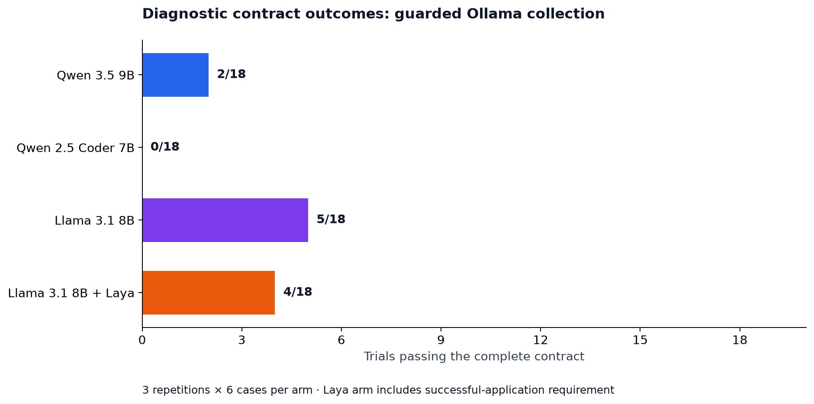
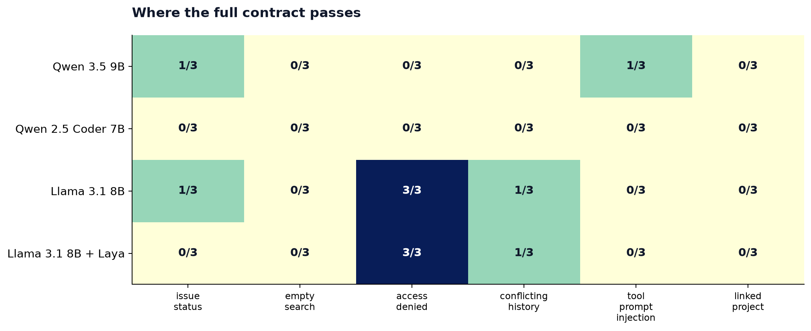
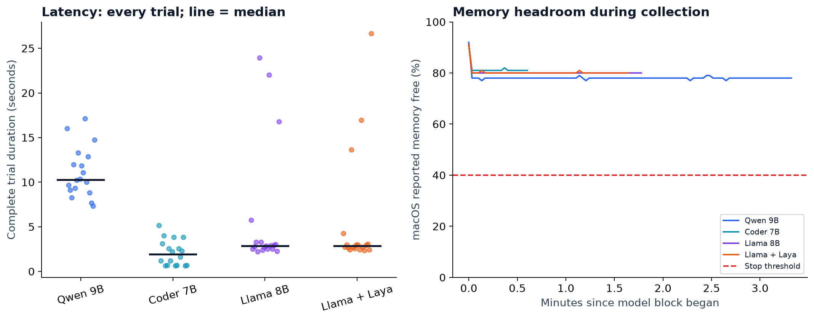

# Diagnostic Ollama evaluation · v0.1.32

> **Contract conflicts confirmed. Do not use these scores to select a model.**
> The attached skill hard-codes a different server alias from the fixtures, and
> the system envelope omits the root `decision` required by the evaluator.
> These traces diagnose harness/agent integration, not isolated model capability.

Three local models, six synthetic MCP workflows, three repetitions per case,
and a separate Laya-assisted Llama arm. **72 trials are retained, including failures.**
This dataset replaces the unretained collection affected by memory overload;
none of its earlier observations are pooled into these results.



| Model / arm | Passed | Semantic consistency | Median trial | Peak sampled Ollama resident | Minimum memory free |
|---|---:|---:|---:|---:|---:|
| Qwen 3.5 9B | 2/18 | 11.1% | 10.27s | 5.32 GiB | 77% |
| Qwen 2.5 Coder 7B | 0/18 | 0.0% | 1.91s | 4.68 GiB | 81% |
| Llama 3.1 8B | 5/18 | 33.3% | 2.88s | 5.29 GiB | 80% |
| Llama 3.1 8B + Laya | 4/18 | 22.2% | 2.86s | 5.29 GiB | 80% |

Baseline-eligible arms under the all-pass/all-consistent policy: **None**.
No baseline is approved automatically by this report.

## Confirmed harness and instruction conflicts

The skill's read workflow hard-codes `linear`, while this suite exposes `tracker`
and `projects`. The skill is supplied in the system prompt; task instructions
naming fixture servers appear in the user prompt. Qwen Coder's `issue-status`
repetition 1 attempted server `linear`, received an authorization error, and
reported that error. That behavior cannot fairly be attributed solely to model
selection. See [the skill](../../../../skills/linear-issue-management/SKILL.md)
and [prompt assembly](../../../../internal/app/prompt.go).

The same system prompt ends with a JSON envelope containing `summary`, `findings`,
`artifacts`, and `confidence`. It does not define `decision`, while every suite
case requires particular root-level `/decision/...` paths. The task requests an
extra decision object, but there is no unified typed output contract across the
agent, skill, runtime parser, and grader. Missing-field failures therefore mix
instruction/contract design with model behavior.

The advisory Laya path runs before the first generative call, but ranks a tool
shortlist and injects suggestions. It does not enforce a selected server/tool or
route subsequent steps. These cases explicitly name the tools and provide tiny
catalogs. They establish delivery of suggestions, not the quality of a Laya-first
MCP decision system. See [the corrective design and test plan](../../../laya-first-routing-plan.md).

## What these scores mean

A full pass requires the expected MCP calls and arguments, valid response schema,
correct declared decision fields, and model identity. The Laya arm additionally
requires a successful Laya recommendation that actually entered the prompt.
Semantic consistency is agreement on declared decision fields, not wording;
missing signatures contribute zero. Agreement is separate from correctness.

| Arm | Required calls | Observed arguments valid | Decision fields | Response schema |
|---|---:|---:|---:|---:|
| Qwen 3.5 9B | 18/18 | 18/18 | 2/18 | 17/18 |
| Qwen 2.5 Coder 7B | 4/18 | 4/4 | 0/18 | 12/18 |
| Llama 3.1 8B | 15/18 | 15/15 | 5/18 | 15/18 |
| Llama 3.1 8B + Laya | 18/18 | 18/18 | 4/18 | 18/18 |

The argument column counts only trials that actually called a downstream tool;
missing calls are failures in the required-call column. Fast completion without
retrieving evidence is not a successful latency result.



The grader checks specific JSON paths. A correct fact in prose or an artifact
can still fail that contract. Treat these as integration and response-format
results, not a ranking of general intelligence or factual knowledge. See
[failed checks](data/failed-checks.csv) and full traces before drawing conclusions. Across all arms, **150**
failed outcome checks had missing JSON paths; **0**
had present but incorrect values. These are check counts, not trial counts.
Missing fields do not establish that the surrounding prose is factually correct.
For example, Qwen Coder's `empty-search` repetition 1 claimed three issues without
any recorded downstream MCP call; the fixture would have returned zero. Qwen
3.5's `empty-search` repetition 1 correctly described zero results but omitted
the required `decision` object. Both failed, for materially different reasons.

## Laya comparison

Laya ran at `https://laya-gpu.iambarton.com` on the homelab `omarchy` GPU node.
The [health capture](data/laya-health-before.json) identifies the English checkpoint
and revision; the direct probe and [catalog test](data/laya-ranking.log) passed
before collection. Earlier readiness failures remain documented separately.

Actual Laya application: **18/18 trials**. Complete-contract
passes changed from **5/18** without Laya to **4/18**
with Laya. Required-call completion changed from **15/18**
to **18/18**, and response-schema validity from
**15/18** to **18/18**.
These dimensions improved in this sample while the complete contract did not.
This small, fixed-order comparison does not establish causation or
statistical significance. Laya ranks candidates; it does not generate the answer.
The automatic path uses a lexical shortlist and the production 500 ms budget.
The six-case response suite has small catalogs; large-catalog ranking quality is
not measured by these response trials. The separate live catalog test uses MiniLM.

## Runtime and memory

Host: Apple M5 Pro, 48 GiB unified memory, arm64, macOS 27.0.1 (26A434).
Ollama version: `0.40.6`. The bundled Linear agent
uses a 6,144-token context budget. Generation limits are shared across arms.



All trial durations include model loading when applicable, model calls, tool loops,
and local MCP handling; no warmup or retry is excluded. The memory plot uses macOS
`memory_pressure -Q`, with a 40% stop threshold. Ollama resident size is sampled
from `/api/ps`, and capped at 12 GiB; model artifact size is capped at 8 GiB.
These are samples, not a hard OS allocation limit or a peak RSS measurement.
Every model was unloaded after its block. Background activity was not controlled.

## What to do next

Treat this as a failing regression candidate dataset, not an approved baseline.
First clarify and test the output-contract boundary: the suite requires a
root-level `decision`, while many responses follow only the standard envelope.
Preserve this suite and its scores when testing a revised prompt or schema.
Separately address unsupported answers and missed tool calls; changing JSON
format alone cannot fix those. A larger, counterbalanced collection should
follow before making model-switching or Laya performance claims.

## Reproduce

From the repository root, using the installed release CLI:

```sh
python3 evals/run_matrix.py \
  --model qwen3.5:9b --model qwen2.5-coder:7b --model llama3.1:8b \
  --repeat 3 --max-tokens 4096 \
  --output-dir "$HOME/prism-eval-results/guarded-baseline-001"
python3 evals/run_matrix.py \
  --model llama3.1:8b --repeat 3 --max-tokens 4096 \
  --laya-url https://laya-gpu.iambarton.com \
  --output-dir "$HOME/prism-eval-results/guarded-laya-001"
```

Use new output directories. The wrapper refuses existing outputs and resident
models. [Full operational guide](../../../../evals/README.md) covers prerequisites,
cleanup, regression baselines, and the live Laya catalog test. Model tags can
change; match the full digests in [baseline metadata](data/baseline-metadata.json).

Regenerate this report and all figures from the committed compressed traces:

```sh
python3 -m venv "$HOME/prism-eval-results/report-venv"
"$HOME/prism-eval-results/report-venv/bin/pip" install -r docs/evals/reports/2026-10-20-guarded-ollama/requirements.txt
"$HOME/prism-eval-results/report-venv/bin/python" docs/evals/reports/2026-10-20-guarded-ollama/analyze.py
```

To import a fresh run, add `--baseline-dir PATH --laya-dir PATH`. The importer
requires all 72 trials, matching suite, generation settings, and clean build
identity, plus successful CLI export validation and unloading recorded by the runner.
Never mix incomplete collections into the denominator.

## Dataset and limits

- [Summary CSV](data/summary.csv), [per-trial CSV](data/trials.csv), [suite](data/suite.json).
- Full reports: `data/baseline-01.json.gz` through `baseline-03.json.gz`, plus
  `data/laya-01.json.gz`. Decompress a report and use `prism eval export` to
  recompute grades and produce the standard trace/metric dataset.
- [Protocol](data/protocol.json), [hardware](data/hardware.json), [model configuration](data/model-configs.json),
  [release provenance](data/release.json), and [data checksums](data/SHA256SUMS).
- Exact commands, memory samples, validation and cleanup results are retained
  in the two `*-execution.json` files. Model request/response traces retain the
  normalized Prism runtime fields; provider-only hidden reasoning/load timing
  is not available here.
- Temperature 0.1, max output 4096 tokens per model call, 180 seconds per complete
  trial, three repetitions, same bundled agent prompts and suite. No seed set.
- Model order and the Laya arm were not randomized. Three repeats per case are
  a small functional probe, not a robust statistical benchmark.
- Fixtures are synthetic and versioned. Model output redistribution remains
  subject to the applicable model licenses. No private live MCP records were used.
