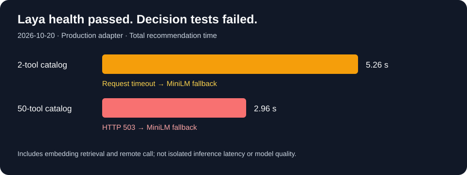

# Evaluation recovery and Laya readiness

**Status: no publishable model ranking yet.** The initial local collection caused
reported memory overload, and its temporary artifacts were subsequently missing.
This report preserves the checks that remain reproducible and the procedure for
collecting the replacement dataset.

| Check | Observed result |
|---|---|
| Release installation | Prism v0.1.31, revision `b7396d9be0955117f96b9d1c887bf8a36bc3734d` |
| Local recovery | No running evals, no resident Ollama models, 92% memory free |
| Laya placement | `laya-759c48865b-cpfrh`, node `omarchy` |
| DNS origin | `https://laya-gpu.iambarton.com` |
| Laya health | English checkpoint on CUDA, zero CPU fallbacks |
| Two-tool recommendation test | Failed: decision request timed out; MiniLM fallback |
| Fifty-tool recommendation test | Failed: decision HTTP 503; MiniLM fallback |
| GPU snapshot | 15,051 MiB used / 16,311 MiB total; not a causal diagnosis |



The durations above include local embedding retrieval and the remote call;
they are not isolated Laya inference latency. The fifty-tool catalog is narrowed
to at most twenty candidates before reranking. Neither result establishes
successful Laya use. Health is necessary but does not prove decision-serving
readiness.

## Evidence and reproduction

- [Unmodified live integration-test log](data/laya-ranking.log)
- [Laya health response](data/laya-health.json)
- [Guarded model matrix, Laya off/on commands, and baseline procedure](../../../../evals/README.md)

The retained live test ran with `PRISM_LIVE_LAYA_URL=https://laya-gpu.iambarton.com`
and `PRISM_TEST_MODEL_STATE=/Users/bbarton/.prism`:

```sh
go test -tags integration ./internal/app \
  -run '^TestRecommendToolsWithLiveLaya$' -count=1 -v
```

No new local generative-model evals were run after the overload report. The
replacement collection should begin with one smaller model, then a sequential
small-model matrix. Keep the large 27B/31B models excluded under the default
resource caps. Laya-assisted response tests must wait for a successful decision
request, retain failures, and use the same experimental CLI in both arms.

The checked-in `--laya-url` implementation uses the actual automatic recommendation
path and records prompt injection, identity, fallback, errors, and timing. Its
500 ms routing budget is unchanged. A separate `laya_applied` check prevents a
correct answer produced after fallback from counting as a successful Laya trial.
Laya-on/off baseline modes cannot be mixed.

The initial unretained counts are intentionally omitted: they cannot be audited,
regraded, or used to establish a regression baseline. No model recommendation or
quality improvement is claimed from these readiness checks.
