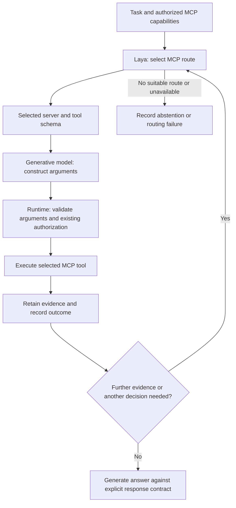

# Laya-first routing and aligned evaluation contracts

Status: corrective design following the v0.1.32 diagnostic collection. This is
not a description of functionality already implemented.

## Confirmed defects in the comparison

1. The Linear skill tells the model to use the `linear` server. The fixtures
   register `tracker` and `projects`, and user-level tasks name those aliases.
   The higher-priority skill and task disagree.
2. The system envelope shows four common fields, while the evaluator requires
   an additional root-level `decision`. The agent, constitution, and skill also
   specify `linear_actions` and `next_action`. They need a single explicit
   response contract that the runtime preserves and the grader validates.
3. The current Laya path is a pre-generation advisory shortlist. The score
   `laya_applied` establishes that a suggestion reached the prompt; it does not
   establish that Laya chose the executed route or made the best decision.
4. The response suite names the intended tool and exposes one or two choices.
   It is not a meaningful routing-quality dataset.

Keep the existing traces and failed checks unchanged. Treat them as diagnostic
evidence. Do not lower thresholds or relabel failed responses as passing.

## Intended execution flow

Laya makes the routing decision before the generative model chooses a downstream
MCP call. The model supplies arguments and synthesis. The runtime binds execution
to the selected server/tool; model-generated server names cannot silently bypass
that decision. Routing selects from authorized capabilities and never grants
permission or authorizes writes.

A route may be selected jointly as a server/tool pair; use a separate server
selection followed by tool selection when catalog size requires it. Evaluate
that tradeoff with realistic catalogs before committing to two network calls
for every step. Make `no suitable route` an explicit outcome. Do not treat raw
choice probabilities as calibrated confidence thresholds without calibration.

Further decisions should be explicit and bounded: select another evidence source,
handle a tool failure, or determine whether enough evidence exists to answer.
Record the decision type, candidate set, selected route, timing, fallback/error,
and the actual executed call. Tool output remains untrusted evidence and cannot
alter routing policy or approval requirements. A Laya-required test fails when
Laya is unavailable; it must not silently become an LLM-only run.

This is a new execution mode, distinct from the existing advisory recommender.
Keep that distinction in configuration and baseline metadata so comparisons
cannot mix the two modes.

## Corrective implementation order

1. Align the response contract in the agent, constitution, skill, prompt builder,
   runtime result parser, and evaluator. Preserve required structured fields
   end-to-end. Use an explicit schema rather than asking the model to infer
   a shape from prose. Keep expected answer values out of model context.
2. Resolve MCP servers from the authorized runtime inventory and capabilities.
   Remove the assumption that a Linear-capable server must be named `linear`.
   Require evidence for factual claims about external records.
3. Add the Laya-first route/argument/execution boundary and per-step decision
   records. Preserve existing authorization, tool budgets, cancellation, and
   read/write controls. Make unavailable/abstain behavior observable.
4. Add deterministic contract and ordering tests before spending inference calls.
5. Run a versioned response suite and a separate routing suite, retaining the
   v0.1.32 dataset unchanged. Use the same memory-guarded small-model runner.

## Tests that must establish the intended behavior

| Layer | Required evidence |
|---|---|
| Contract | The exact schema reaches the model and survives parsing into the MCP result; the grader checks that same schema |
| Alias handling | Equivalent Linear MCP servers under different authorized names behave consistently |
| Routing order | Laya request occurs before the first generative argument request and before downstream execution |
| Route enforcement | The executed server/tool matches Laya's selection; a model attempt to switch targets cannot bypass it |
| Routing quality | Multiple plausible authorized servers/tools and distractors, randomized candidate order, tasks without exact server/tool names |
| Evidence loop | Linked-record tasks trigger a new decision with retained evidence; unavailable or conflicting sources have explicit outcomes |
| Failure handling | Timeout, malformed distribution, no suitable route, denied access, and injection attempts remain visible and fail the relevant checks |
| Model comparison | Identical prompts, schemas, fixtures, generation limits, decision mode, and model identity metadata |
| Resource use | Sequential models, persistent traces, memory telemetry, bounded inference, and unloading after every block |

Compare aligned agent/skill behavior with Laya off, advisory Laya, and Laya-first
routing as separate arms. Assess route correctness, actual tool use, factual
outcomes, schema validity, and latency separately. Approve a regression baseline
only after the full intended contract passes consistently.
